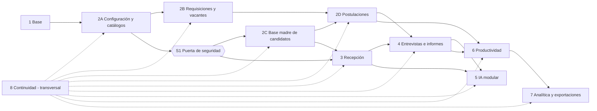

# Plan maestro (cada fase requiere autorización expresa)

Principios permanentes: **Security & Privacy by Design** ([`SEGURIDAD.md`](SEGURIDAD.md)), solo datos ficticios hasta
autorización, TEST y producción separados, migraciones incrementales, planes gratuitos cuando sea viable.

## Estado general

| Fase | Tema | Estado | Depende de |
|---|---|---|---|
| 1 | Base técnica, autenticación, dashboard, esquema, RLS | ✅ Publicada | — |
| 2A | Clientes, usuarios, configuración y **catálogos** | 🔍 En revisión (PR #3) | 1 |
| 2B | Requisiciones y vacantes | ✅ Validada en TEST (PR #4) | 2A |
| **S1** | **Puerta de seguridad previa a datos reales** | 🔍 Técnica lista (rama `claude/fase-s1-seguridad`); pendientes de la empresa | 2A |
| 2C | **Base madre de candidatos** (incl. importación de ~2.700 registros) | 🔍 Técnica lista (rama `claude/fase-2c-candidatos`); datos reales tras S1 | 2A, **S1** |
| 2D | Postulaciones y seguimiento del proceso | 🔍 Técnica lista (rama `claude/fase-2d-postulaciones`) | 2B, 2C |
| 3 | Recepción de candidatos (bandeja, CV, formularios públicos, integraciones) | 🔍 Técnica lista (rama `claude/fase-3-recepcion`); publicación externa tras S1 | 2C, S1 |
| 4 | Entrevistas, evaluaciones e informes ejecutivos | 🔍 Técnica lista (rama `claude/fase-4-evaluaciones`); falta el machote oficial | 2D, 3 |
| 5 | Inteligencia artificial modular | 🔍 Técnica lista con proveedor simulado (rama `claude/fase-5-ia`); proveedor externo requiere autorización de costos | 3, 4, S1 |
| 6 | Productividad y seguimiento («Mi jornada») | 🔍 Técnica lista (rama `claude/fase-6-jornada`) | 2D, 4 |
| 7 | Analítica, indicadores y exportaciones controladas | 🔍 Técnica lista (rama `claude/fase-7-indicadores`) | 2D, 6 |
| 8 | Mantenimiento, respaldos, monitoreo, recuperación y continuidad | Transversal desde 2A | — |

---

## Fase 2A — Configuración y catálogos (en revisión)
Detalle en [FASE2_PLAN.md](FASE2_PLAN.md). Incluye catálogos de etapas, puestos, requisitos y niveles de dominio;
procesos por cliente y puesto; duplicación y reutilización de configuraciones.

## Fase 2B — Requisiciones y vacantes (en revisión)
**Entregado:** alta y edición de requisiciones y vacantes (cliente y puesto de los catálogos, plazas, ubicación,
salario, horario, modalidad); flujo de aprobación en la BD; responsables, prioridades y fechas límite (con aviso de
vencidas); duplicación de vacantes (misma u otra requisición) con su proceso y requisitos; proceso y requisitos
personalizables por vacante; seguimiento de plazas cubiertas/pendientes («cubierta» automática); filtros y
paginación. **Pendiente para fases posteriores:** duplicar requisiciones y guardarlas como plantillas, tareas y
próximos pasos (fase 6), verificación programada (fase 8).

Plan original:
- Alta y edición con flujo de aprobación aplicado en la base de datos.
- **Duplicar** requisiciones y vacantes y guardarlas como plantillas.
- Vacante con puesto del catálogo; proceso y requisitos **resueltos automáticamente**
  (vacante → cliente+puesto → cliente → puesto → estándar) y **personalizables por vacante**.
- Responsables, fechas límite, tareas y próximos pasos básicos.
- Fase 8: verificación programada de disponibilidad y alertas.

## Puerta S1 — Seguridad previa a cualquier dato real (obligatoria)
**Estado (migración 0900):** 1 ✅ técnico (falta que cada usuario la configure y un admin la exija) · 2 ✅ · 3 ✅ técnico
(falta generar la clave GPG y cargar los secretos) · 4 ⏳ aprobación de la empresa · 5 ⏳ revisión jurídica
([`LEY_8968_REVISION.md`](LEY_8968_REVISION.md)) · 6 ⏳ al cerrar 2C.

Ningún dato personal real (importación, formularios públicos, CV) entra al sistema hasta completar:
1. **Autenticación multifactor (TOTP, gratuita en Supabase)** obligatoria para usuarios internos, exigida también
   en RLS (`aal2`).
2. **Registro de accesos** a datos sensibles, descargas y exportaciones.
3. **Respaldos cifrados** programados y **una restauración verificada** en TEST.
4. **Protocolo de respuesta ante incidentes** aprobado (ver OPERACION.md §6).
5. **Revisión jurídica** del texto de consentimiento, finalidades, plazos de conservación y base legal de los
   registros existentes (Ley 8968 y su reglamento).
6. Revisión de seguridad independiente del código de 2C (sin riesgos críticos ni altos abiertos).

## Fase 2C — Base madre de candidatos
**Entregado (migración 1000):** ficha en el orden acordado, datos sensibles separados, consentimiento versionado,
cantones (84, catálogo) · distrito y localidad como texto (el catálogo oficial de distritos se cargará desde la fuente
del INEC/TSE), perfiles múltiples, fuentes, búsqueda avanzada y por dato de contacto, historial de participación,
duplicados con revisión humana y fusión, importación CSV/Excel con validación, decisiones y reversión.
**Ensayo de 2.700 registros ficticios:** automatizado (validación ≈18 s, importación ≈4 s en el entorno de pruebas).
**Pendiente:** derechos ARCO y plazos de conservación (tras la revisión jurídica), importación real tras S1.

**Orden de la ficha:** 1. Nombre completo · 2. Teléfono · 3. Correo electrónico · 4. Provincia · 5. Cantón ·
6. Distrito · 7. Localidad · 8. Puesto o perfil profesional · 9. Fuente de recepción.
- **Cédula opcional** (muchos CV no la incluyen); única cuando existe.
- División territorial de Costa Rica (provincia → cantón → distrito) como catálogo.
- **Múltiples perfiles profesionales** por candidato (catálogo de puestos, abierto).
- **Detección de duplicados**: cédula normalizada (bloqueo); teléfono E.164, correo y nombre (revisión humana).
- **Historial de postulaciones** y **actualización del expediente** con trazabilidad (quién y cuándo).
- **Alimentación continua** del banco de talento, independiente de las vacantes activas.
- Datos sensibles en tabla separada (`candidate_private`), invisibles para `consulta`; lectura registrada.
- Consentimiento informado versionado obligatorio.
- **Importación masiva (~2.700 registros):**
  1. Plantilla CSV/Excel con el orden de la ficha y validación previa (informe de errores y duplicados).
  2. **Ensayo en TEST con 2.700 registros ficticios.**
  3. Importación real **solo tras S1, revisión jurídica y autorización expresa**, en producción, con bitácora y
     posibilidad de revertir el lote.

## Fase 2D — Postulaciones y seguimiento
**Entregado (migración 1100):** vinculación candidato–vacante (desde el tablero o la ficha), tablero Kanban con las
etapas del proceso de la vacante (arrastrar o «Mover a…»), motivo de descarte obligatorio, contratación con control de
plazas, seguimiento de requisitos con nivel alcanzado, calificación y próximo paso, observaciones «equipo» o
«confidencial», historial inalterable, listado con filtros.

Kanban por vacante (etapas configuradas), historial de etapas, notas con nivel de confidencialidad, motivo de
descarte obligatorio, próximos pasos, un candidato en varias vacantes sin duplicar expediente.

## Fase 3 — Recepción de candidatos
**Entregado (migración 1200):** formularios públicos por vacante y del banco de talento, preguntas de preselección
configurables (Sí/No, opción, número, texto; criterio eliminatorio opcional), enlaces por canal de recepción con
**código QR**, consentimiento digital con evidencia, currículum en almacenamiento privado (PDF/DOCX validado por
contenido, 5 MB), incorporación automática a la base madre sin coincidencias, **bandeja de revisión** de posibles
duplicados (vincular, crear o descartar), carga de currículums desde la ficha y descargas registradas.
**Pendiente dentro de la fase:** Cloudflare Turnstile (recomendado antes de datos reales), carga masiva de CV e
integraciones (correo, Google Forms, WhatsApp, portales).

- **Bandeja centralizada** de recepción con clasificación y asignación.
- **Carga individual y masiva de CV** (almacenamiento privado, validación de tipo/tamaño, nombres aleatorios).
- **Formularios públicos personalizados por vacante**, **enlaces individuales y códigos QR**, **formulario
  permanente** para el banco de talento; protección anti-bots (p. ej. Cloudflare Turnstile, gratuito) y límites.
- **Identificación de la fuente** de recepción en cada ingreso.
- Integraciones progresivas, en este orden: correo electrónico → Google Forms → WhatsApp (evaluar costos de la API
  oficial) → plataformas de empleo (según disponibilidad de API y condiciones).

## Fase 4 — Entrevistas, evaluaciones e informes
**Entregado (migración 1300):** banco de preguntas por puesto y cliente; entrevistas con guion automático, notas y
calificación por pregunta y recomendación; tipos de evaluación (Excel, inglés, SAP, campo, psicométrica) configurables
por vacante como obligatorias, deseables o no aplicables, con resultado por puntaje o nivel; credenciales (licencias,
carné de manipulación de alimentos, certificaciones) con respaldo, verificación y alertas de vencimiento; informe
ejecutivo versionado con plantilla editable y exportación registrada a Word y PDF.
**Pendiente de la empresa:** entregar el **machote oficial** del informe y los instrumentos de las pruebas de Excel
e inglés (se cargan como plantilla y descripción; hoy la plantilla es provisional).

Recursos existentes de TPC a incorporar: **machote de informe ejecutivo**, **prueba de Excel**, **prueba de inglés**.
- Banco de preguntas personalizable por puesto; entrevistas adaptadas a cliente y vacante.
- Evaluaciones **obligatorias, deseables o no aplicables** según la vacante.
- Pruebas de Excel, inglés, SAP, de campo y otras; resultados con nivel (escalas del catálogo).
- Validación de documentos, licencias, certificaciones y **carnés de manipulación de alimentos**, con **control de
  vigencia** y alertas de vencimiento.
- **Informe ejecutivo con el machote oficial de TPC**, exportable a **Word y PDF** (exportación registrada).

## Fase 5 — Inteligencia artificial modular
**Entregado (migración 1400):** interfaz común de proveedores (simulado y Anthropic/Claude con salida estructurada
validada); funciones: extracción del perfil desde el texto del CV, comparación vacante ↔ candidato, preguntas de
entrevista (agregables al banco), borrador del informe ejecutivo (completa solo secciones vacías) y publicación de
la vacante; seudonimización previa, revisión humana obligatoria, límites diarios, presupuesto mensual y registro de
tokens y costos. **Pendiente:** autorización de costos y acuerdo de tratamiento de datos para activar el proveedor
externo; búsqueda inteligente en la base madre (requiere índice semántico) y comunicaciones a candidatos.

- **Arquitectura por proveedores** (interfaz común; cambiar de proveedor sin reescribir funciones).
- Extracción y clasificación de CV; búsqueda inteligente en la base madre; comparación vacante ↔ CV;
  preguntas de entrevista; redacción de informes; publicaciones y comunicaciones.
- **Revisión humana obligatoria** antes de usar cualquier resultado.
- **Protección de datos:** minimización y seudonimización, sin entrenamiento con datos de TPC, proveedores con
  acuerdos de tratamiento, registro de cada uso.
- **Control de consumo y costos** (límites por usuario y mensuales, alertas). Requiere autorización de costos.

## Fase 6 — Productividad y seguimiento
**Entregado (migración 1500):** página **Mi jornada** con entrevistas próximas y sin resultado, próximos pasos
vencidos, etapas con tiempo excedido, evaluaciones obligatorias e informes pendientes, credenciales por vencer y envíos
por revisar; tareas y recordatorios (incluido el **seguimiento a clientes pendientes de respuesta**) con asignación
por coordinación; **indicadores de gestión y productividad** por responsable y período; **calendario** por suscripción
(Google, Outlook, Apple) y descarga .ics por entrevista. La duplicación de vacantes y la reutilización de plantillas
(procesos y requisitos) ya existían desde la fase 2B.

Centro de actividades **«Mi jornada»**; alertas de entrevistas, evaluaciones e informes pendientes; seguimiento de
clientes pendientes de respuesta; recordatorios de vencimientos; indicadores de gestión y productividad; duplicación
de vacantes y reutilización de plantillas; integración con calendarios.

## Fase 7 — Analítica y exportaciones controladas
**Entregado (migración 1600):** tablero ejecutivo (requisiciones y vacantes abiertas, cobertura de plazas, embudo,
contrataciones, días a contratación, conversión), motivos de descarte, tiempos por etapa (promedio, mediana y
objetivo), fuentes más efectivas, desempeño por reclutador y por cliente, con filtros por período y cliente; y
exportaciones a Excel o CSV con rol, motivo, límite, cuota y registro.

Tablero ejecutivo, tiempos por etapa, fuentes más efectivas, desempeño por reclutador y cliente; exportaciones solo
por rol autorizado, con límite, motivo y registro.

## Fase 8 — Mantenimiento, respaldos, monitoreo, recuperación y continuidad (transversal)

**Objetivo:** que el sistema siga operando, que la información pueda recuperarse y que los problemas se detecten
antes que los usuarios. Se incorpora progresivamente desde 2A (ver §15 de FASE2_PLAN.md).

### 8.1 Respaldos
- Supabase gratuito **no ofrece respaldos descargables ni restauración a un punto en el tiempo**: respaldo propio.
- `pg_dump` programado con GitHub Actions, **cifrado antes de guardarse** (clave privada custodiada por la empresa
  fuera de GitHub) y con retención limitada. Requiere autorización y credencial de solo lectura.
- Archivos (fase 3): respaldo del almacenamiento con el mismo esquema.

### 8.2 Recuperación ante fallos
- RPO y RTO definidos por la empresa. Restauración documentada y **probada periódicamente en TEST**.
- Aplicación: *Rollback* en Cloudflare. Base de datos: migraciones aditivas con reversión documentada.

### 8.3 Monitoreo y alertas
- `/api/salud` (sin datos) · verificación programada con alerta · métricas de Cloudflare y uso de Supabase ·
  prevención de la pausa por inactividad de Supabase gratuito.

### 8.4 Mantenimiento
- Actualización mensual de dependencias, revisión trimestral de usuarios y accesos, limpieza según retención.

### 8.5 Continuidad operativa
- Manual de operación, al menos **dos administradores** con MFA por servicio, traspaso documentado, plan de
  contingencia.

## Pendientes de configuración
- ✅ Producción: Supabase, migraciones 0100–0700, registro público desactivado, administrador, Cloudflare (`main`).
- ✅ TEST: proyecto Supabase, migraciones 0100–0800, datos ficticios, Worker `tpc-recruitment-hub-test`.
- ✅ TEST: migraciones 0810 y 0820 aplicadas y verificadas. Producción: 0100–0700; pendientes 0800, 0810, 0820, 0830 y 0840.
- ✅ TEST: migración 0820 aplicada y verificada (2026-11-24); Worker `tpc-recruitment-hub-test` publica la rama de 2B.
- ✅ TEST: 0830 (edición del catálogo de requisitos) y 0840 (plazas autorizadas) aplicadas y verificadas.
- ⏳ Producción: 0820, 0830 y 0840 solo después de 0800/0810 y con autorización expresa.
- ✅ TEST: 0900 (puerta S1) aplicada y verificada (2026-11-25). ⏳ Configurar la verificación en dos pasos de los usuarios de prueba.
- ✅ TEST: 1000 (fase 2C) aplicada y verificada (2026-11-25). ⏳ Ensayo de importación con `scripts/generar-candidatos-ficticios.mjs`.
- ✅ TEST: 1100 (fase 2D) aplicada y verificada (2026-11-25); Worker `tpc-recruitment-hub-test` publica `claude/fase-2d-postulaciones`. ⏳ Validación manual de S1, 2C y 2D.
- ⏳ Verificación en dos pasos en GitHub, Supabase y Cloudflare para las cuentas administradoras.
- ⏳ Revisión jurídica (Ley 8968): consentimiento, finalidades, retención, registros existentes.
